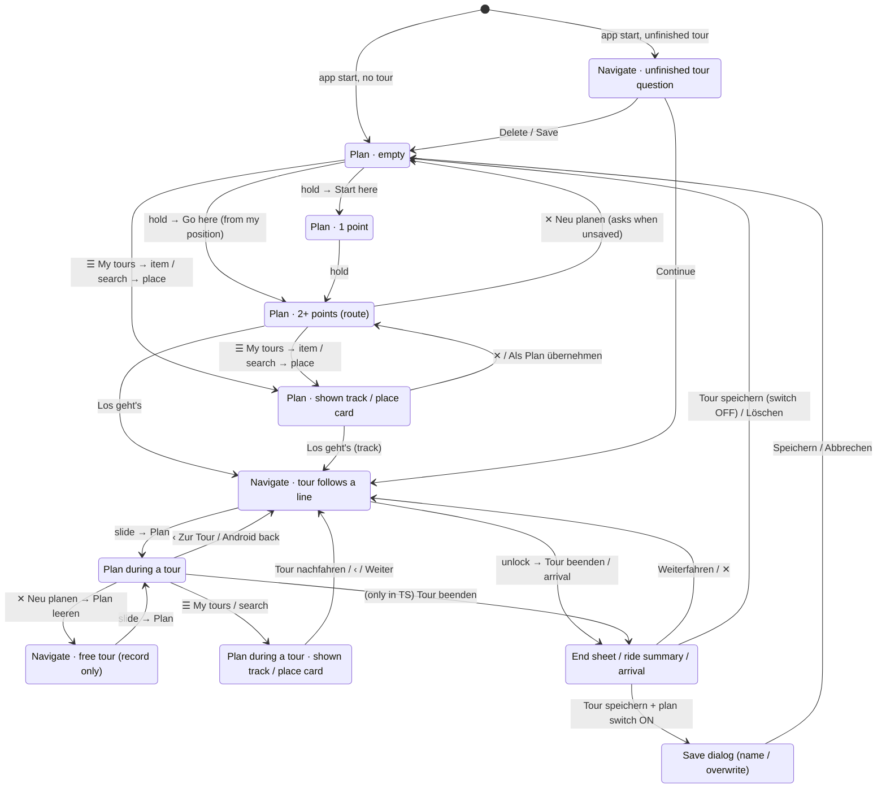

# Flow map – every state, every button, and where it leads (2026-11-06)

Owner 2026-11-06: "alle Abläufe durchspielen … ob wir noch ähnliche Sackgassen oder unlogische Sachen haben". Read from
the code of main 7259f41e (AppViewModel, MapScreen, NavigateScreen, PlanPanel, TourBar, TourActionBar, PlanTopBar,
MapOverlays, MapHost, Panels, RouteDialogs, search/PlaceCard). Unsure findings were probed on the emulator
(`FlowMapProbeE2ETest`, kept off main – each probe passes when the suspected behaviour is there; all three passed again on
7259f41e, 2026-11-06 17:20). Data-loss paths are in
`docs/design/save-paths.md` and are only referenced here; the Pixel review of 2026-11-06 (backlog "Pixel review
2026-11-06 – open bugs") likewise.

## Main states

## State table (what is on screen → where each button leads)

Axes: mode (Plan / Navigate locked / unlocked), plan (empty / 1 / 2+ unsaved / saved / saved + changed / track shown),
tour (none / follows a line / free / paused / lead to start / arrived), open layer (sheet step, ☰, dialog, box, My tours,
search, pin card, activity sheet).

| # | State | Buttons and gestures → result (saved / dropped) |
|---|-------|-------------------------------------------------|
| S1 | Plan · empty · no tour | hold → first-point menu (Start here → S2 / Go here → S3, disabled without GPS fix with the reason); tap → "hold to set a point" line; search → S9; ☰ → My tours (S8) / Settings / Pair; activity button → activity dialog; **no start button in any sheet step** (H1) |
| S2 | Plan · 1 point · no tour | hold → second point (S3); hold the point → point menu (Delete…); Undo; **no start button** (H1) |
| S3 | Plan · 2+ points · no tour | green "Los geht's" (sheet foot / rolled-up row) → straight legs? "Navigate anyway?" → N1; ✕ Neu planen → unsaved: "Plan leeren?" (Save · Verwerfen · Abbrechen) else clears (Undo); ⇅ Umkehren; ↻ Rundtour; hold map → smart insert / append as new goal; hold point → point menu; Undo / Redo; ☰ Save route → Save dialog; ☰ My tours → S8 |
| S4 | Plan · shown track (My tours / import) · no tour | ✕ → back to the plan; "Als Plan übernehmen" → plan replaced, no question (save-paths 8); green "Los geht's · <activity>" → follows the track, recording starts (N1) |
| S5 | Plan · place card (search / pin) · no tour | Hierhin / + Hinzufügen / Start / Ziel / Google / ✕ |
| S6 | Plan · during a tour (TP) | band "‹ Zur Tour" (= Android back) → Navigate (pause kept); ✕ Neu planen → "Plan leeren? Deine Tour läuft weiter" → free tour; plan edits → the tour follows the new plan; rolled-up row and foot have **no** green button; **no Pause / End here** (only in S7) |
| S7 | Plan · during a tour · shown track or place card (TS) | tour card on top: green "Weiter · <activity>" (resumes a pause, back to the OLD guidance), "Pausieren", red "Tour beenden"; track sheet: "Als Plan übernehmen", green "Tour nachfahren" → follows the track, **old plan stays in Plan** (M1); place card: its own primary button (F1 in save-paths.md) |
| S8 | My tours (overlay) | Geplant / Gemacht / Tracks tabs, search; tap planned → no tour: "Plan ersetzen?" when unsaved / during a tour: box "Mit dieser Route weiter · Tour beenden und laden · Abbrechen"; tap done / imported → S4 / S7 (no question); ⋮ → export, copy, delete (bin) |
| S9 | Search (full screen) | result → S5 (pin + card); back → Plan |
| N1 | Navigate · locked · follows a line | slide "» Entsperren" → N2; activity in the status card → activity check sheet; ⚙ navigation settings; eye; whole route; locate; off-route boxes (take / keep / via), far start (lead / just record), mid start (join / lead) |
| N2 | Navigate · unlocked (30 s, a map tap or back locks) | status card: Pause, Tour beenden; bottom: Sperren · blue "Plan" → S6 |
| N3 | Navigate · paused | stays unlocked; "Fortsetzen"; Tour beenden; Plan |
| N4 | Navigate · free tour ("Freie Tour · nur Aufnahme") | as N1/N2 without turn card |
| N5 | Arrival sheet (Navigate only; in Plan it waits) | Tour speichern (switch "… Plan auch speichern" when the plan is unsaved) / Weiterfahren / ✕ / Löschen |
| N6 | End sheet "Tour beenden?" | Tour speichern → (rides found: ride summary) → plan switch ON → Save dialog (plan kept until answered, fixed 894ab407) → "Tour gespeichert" box (Löschen · GPX · Fertig) → S1; Weiterfahren / ✕ → back; **Löschen → tour to the bin and the plan leaves, switch ignored** (H2) |
| N7 | Unfinished tour (after a restart / kill) | Continue · Delete · Save |

16 states (S1–S9, N1–N7) plus 5 dialogs / boxes reached from them (Save, "Plan leeren?", "Plan ersetzen?", tour-load box,
ride summary); 39 transitions written out above (gestures that only move the map not counted).

## Inputs for the common goals (from the code)

| Goal | Inputs | Steps |
|------|--------|-------|
| New plan and go (GPS fix) | **3** | hold → Hierhin → Los geht's (+1 when straight legs ask) |
| Record without a plan | **impossible** (H1) | – |
| Pause / resume (locked Navigate) | **2 / 1** | slide → Pause / Fortsetzen |
| End and save the tour | **3–5** | slide → Tour beenden → Tour speichern (→ Save dialog Speichern when the switch is on) → "Tour gespeichert" Fertig |
| Change the destination on the way | **6** | slide → Plan → hold new spot (appended; the old goal becomes a stop) → hold old goal → Delete → ‹ Zur Tour (M3) |
| Follow a saved (planned) route, no tour | **4–5** | ☰ → My tours → tap → (Plan ersetzen? when unsaved) → Los geht's |
| Follow a done tour during a tour | **7** | see save-paths.md "Flow" (F1–F3 there) |
| Clear the plan on the way and start a new one | **7** | slide → Plan → ✕ → Plan leeren (or Speichern first) → hold → Hierhin → ‹ Zur Tour |
| From Plan back to Navigate (during a tour) | **1**, but top left | the round blue "‹" in the band (or Android back) – far from the thumb; **being built:** C, a green "Navigation" button at the very bottom instead (owner 2026-11-06) |

## Findings

### High

| # | Finding | Code | Emulator | Proposal (one sentence to decide) |
|---|---------|------|----------|-----------------------------------|
| H1 | **A tour without a plan cannot be started.** With 0 or 1 plan points there is no start button in any sheet step (`PlanBarRow.shown` and `CompactGo` need 2 points since R5, 2026-11-05) and ☰ has no "Aufnahme starten" (removed 2026-11-02, #15, because "the green button records without a route"). The label "Los geht's · ohne Route" (`PlanStart.RECORD_ONLY`) is unreachable; the comment in `PlanBarRow` still says "one point only records: the rolled-up row / ☰". | `PlanPanel.kt:487`, `:650`; `PlanTopBar.kt:264` | **yes** – 0 and 1 point, every sheet step; ☰ = My tours · Pair · Settings | With an empty or one-point plan the sheet shows the green "▶ Los geht's · ohne Route" again (recording only) – yes / no? |
| H2 | **"Löschen" in the end / arrival sheet also drops the unsaved plan, although the switch "… Plan auch speichern" is ON.** `onDelete` sets the switch off and ends the tour; `RecordingService.finished` clears the plan; no question, Undo only. The switch sits right above, so "delete the tour, keep the plan" is what the sheet suggests. | `MapScreen.kt:227`, `:239`; `AppViewModel.kt` finished collector | **yes** – plan 0 points after, nothing in Planned, no question | "Löschen" with the switch ON saves the plan first (same Save dialog as "Tour speichern") – yes / no? |

### Medium

| # | Finding | Code | Emulator | Proposal |
|---|---------|------|----------|----------|
| M1 | **Two routes after "Tour nachfahren" during a tour.** The followed done tour is drawn blue as the guidance, and the old plan stays in Plan (blue line, numbers, km, "Gespeichert als …") – Plan no longer shows what Navigate follows (owner rule "what Plan shows = what Navigate follows"). One edit of that old plan (or Undo) and "‹ Zur Tour" silently switches the guidance from the track back to the plan. | `AppViewModel.followShown` (:3333), `continueNavigation` (:2880), `PlanGuidance.planReplacesTrack` | **yes** – old plan (2 points) in Plan while the track is followed; after ⇅ + ‹ Zur Tour the track is no longer followed | Following a done tour during a tour asks once "Plan durch diese Tour ersetzen?" (Ersetzen = the track becomes the plan via TrackToPlan, like "Als Plan übernehmen") – yes / no? |
| M2 | **Pause / End only sometimes in Plan.** *(being built: F1, onpath.private#33 – the status line only)* During a tour the plan sheet has no Pause / End (R1: "‹ Zur Tour" leads back), but over a shown track or a place card a tour card with Weiter / Pausieren / red Tour beenden appears (the 14:37 screen). Same tour, two different control sets in Plan. | `MapScreen.kt:348` | no (code is clear) | Take F1 of save-paths.md for both: during a tour Plan never shows tour buttons, only the status line – yes / no? |
| M3 | **Changing the destination on the way = 6 inputs**, and a hold on the open map appends a new goal: the old goal silently becomes a stop that must be deleted by hand. | `MapHost.kt:233` `addPoint`, `PlanEdits` | no | The hold menu during a tour gets "Neues Ziel" (replaces the goal) beside "Als Stopp" – yes / no? |
| M4 | **"‹ Zur Tour" and "Weiter" do different things to a pause.** *(the new bottom button C must decide it once)* The band's ← (and Android back) goes to Navigate and keeps the pause; the tour card's green "Weiter" (S7) and the rolled-up `goClick` resume it. | `PlanTopBar onBackToTour` → `continueNavigation`; `TourBar.kt:326`; `PlanPanel.kt:636` | no | Back to the tour never changes the pause (Navigate shows "Fortsetzen" anyway) – yes / no? |

### Small

| # | Finding | Code | Emulator | Proposal |
|---|---------|------|----------|----------|
| K1 | The activity button opens two different things: without a tour the activity dialog (all six + T level), during a tour the check-and-switch sheet (Hike only with the remembered T, Pixel review). | `MapScreen.kt:163` | no | One sheet for both, with T1–T5 during a tour too – yes / no? |
| K2 | `TourStatusRow` (one-row status + red "Beenden") is no longer used anywhere. | `TourBar.kt:368` | – | Delete it (tidy, no owner decision). |
| K3 | `RouteMenuState.startRecording` is computed but no menu item reads it (left over from the removed ☰ item). | `RouteRules.kt:73` | – | Delete with H1's decision. |

Referenced, not repeated: save-paths.md 1 (fixed 894ab407), 2, 6, 8, 12 and the follow-a-done-tour flow (F1–F3); the
Pixel review's "PLAN ÄNDERN" without a plan, "Geänderten Plan" for a new plan, the second "Tour gespeichert" box, the
past arrival time, the triangle over the activity sheet (pin card text done 8123d06a; its size was a wrong density – 48 dp).
Being built in parallel, not repeated: F1 (shown tour during a tour: 2 buttons), no second "Tour gespeichert" box
(onpath.private#35), C (green "Navigation" at the bottom of Plan during a tour instead of the band's "‹").

## Colour rule audit

Owner 2026-11-06: "es ist alles blau, und was zur Navigation geht, grün" (ui-style.md colour rule, owner 2026-11-02;
#27: Pause and Tour beenden are green, nothing red on stopping). Green = into Navigate / start, continue, pause, end the
tour (`OnPathColors.ActionGo`, theme `primary` = `Green`); blue = plan / change (`ActionEdit`, `PlanAccent`); neutral
(cancel, OK, close, external) = grey / outlined; delete = red allowed. **Pitfall:** the theme's `primary` is green, so
every `Button` / `TextButton` / `OutlinedButton` without its own colours is green – most violations below are buttons
that never chose a colour. 152 buttons scanned (`Button`, `TextButton`, `OutlinedButton`, `FilledTonalButton`, FABs)
plus the hand-made ones (plan pills, pin card, go row, slider); Settings / setup / backup / offline maps / sync / update
pages (80 buttons) are one group (C17).

### Violations

| # | Where (file:line) | Text | Today | Does | Should be |
|---|-------------------|------|-------|------|-----------|
| C1 | `search/PlaceCard.kt:108` | "Als Stopp 2 einfügen" / add (search result / candidate card) | green filled (default) | plans | blue filled |
| C2 | `search/PlaceCard.kt:125`, `:129` | "Als Start", "Als Ziel" | green outlined (default) | plans | blue outlined |
| C3 | `Panels.kt:143` | "Als Plan übernehmen" (shown track) | green outlined (default) | plans | blue (F1 builds it) |
| C4 | `TourBar.kt:382` (`TourRunningBar`, Plan over a shown track / place) | "Tour beenden" | **red** outlined | ends the tour | green outlined (#27) – F1 removes this card |
| C5 | `TourBar.kt:432`, `:437` (`TourPauseEnd`, same card) | "Pausieren" / "Tour beenden" | light **blue** tonal (`secondaryContainer`) / **red** + ■ | pause / end | green tonal / green outlined (#27) |
| C6 | `PlanTopBar.kt:148` | round "‹" back to the tour | **blue** | into Navigate | green – C replaces it with the green bottom button |
| C7 | `RouteDialogs.kt:107` (Save dialog) | "Speichern" | green text (default) | saves the plan | blue (the "Plan speichern?" decision dialog already uses blue, `RouteDialogs.kt:166`) |
| C8 | `Screens.kt:425` ("Plan ersetzen?") | "Ersetzen" / "Zuerst speichern" | green text (default) | plans | blue |
| C9 | `RouteDialogs.kt:75` (straight legs) | "Route korrigieren" | green text (default) | plans | blue ("Trotzdem navigieren" beside it is green – right) |
| C10 | `TourBar.kt:492` (`LongRouteDialog`) | "Trotzdem planen" | green text (default) | plans | blue |
| C11 | `MapScreen.kt:387` (slow plan box) | "Weiter warten" (main button) | green filled (`MessageCard` main = always `Green`, `MessageCard.kt:265`) | plans | blue – `MessageCard` needs a colour per box |
| C12 | `PlanPanel.kt:659` (`NotRoutedBar`) | "Berechnen" / "Trotzdem planen" | green text (default) | plans | blue |
| C13 | `MapScreen.kt:375` (shared place unsure) | "Suchen" | green filled (`MessageCard`) | search / plan | blue |
| C14 | `poi/PoiSheet.kt:117` | "In Google Maps öffnen" | green filled (default) | leaves the app | neutral outlined |
| C15 | `PlanPanel.kt:352` and the dialogs' "Abbrechen" / "OK" / "Schließen" (`MapLoad.kt`, `BackgroundDownloads.kt`, `Screens.kt:203`, `:413`, `:523`, `RouteDialogs.kt:57`, `:108`) | cancel / close | green text (default) | neutral | grey (`onSurfaceVariant`) |
| C16 | `MessageCard.kt:268` – every second button of a box ("Abbrechen", "Nicht jetzt", "Nur aufzeichnen" …) | | green text | mixed | per box: neutral grey or the box's colour |
| C17 | Settings, setup guide, backup, offline maps, sync, updates (80 buttons) | "Laden", "Prüfen", "Exportieren", "Installieren" … | green (default) | neither Navigate nor plan | neutral or blue – the owner decides once for "settings pages" |

### Follows the rule (checked)

Green for Navigate: plan sheet "▶ Los geht's" / "Navigation" (`PlanPanel.kt:596`, `:544`, rolled-up row `:548`), track
panel "Los geht's · <activity>" / "Tour nachfahren" (`Panels.kt:155`), slider "» Entsperren" (`SlideToUnlock.kt:100`),
Navigate "Pause" (tonal green, `TourActionBar.kt:56`) and "Tour beenden" (green outlined, `:61`), "Sperren" (`:89`),
paused "Fortsetzen" (`NavigateScreen.kt:521`), "Weiter · <activity>" (`TourBar.kt:326`, `:389`), end / arrival sheet
"Tour speichern" (green filled, `TourBar.kt:257`) and "Weiterfahren" (`:215`), "Zurück zum Start" (`:468`), "Trotzdem
navigieren" (`RouteDialogs.kt:74`), the tour-load box "Mit dieser Route weiter" (`Notices.kt:131`), off-route / far-start /
mid-start boxes in Navigate (`NavigateScreen.kt:746`–`784`), the activity sheet "… beibehalten" during a tour
(`ActivitySwitchSheet.kt:109`). Blue for the plan: "Plan" in Navigate (`TourActionBar.kt:97`), pin card "+ Hinzufügen" /
"Hierhin" (`MapOverlays.kt:255`), plan pills ✕ Neu planen · ⇅ Umkehren · ↻ Rundtour (`PlanPanel.kt:242`, `PlanAccent`),
search glass / ☰ / map buttons in Plan (`PlanTopBar.kt`, `MapFooter.kt:140`), the "Plan speichern?" / "Plan leeren?"
decision dialog (`RouteDialogs.kt:166`). Red only for deleting: end sheet "Löschen" (`TourBar.kt:220`), "Tour löschen"
(`:273`), "Verwerfen" (`RouteDialogs.kt:167`), menu "Löschen" rows (`MapOverlays.kt:395`).

**Proposal (one sentence each):** give `MessageCard` and the plan dialogs an explicit colour (blue in Plan, green in
Navigate, grey for cancel) and stop relying on the green theme `primary` – yes / no? Settings pages (C17) neutral grey –
yes / no?

## How the probes ran

`app/src/androidTest/java/com/onpath/app/e2e/FlowMapProbeE2ETest.kt` on the donald emulator via
`FLOWS=com.onpath.app.e2e.FlowMapProbeE2ETest tools/dev/device.sh emulator -- tools/ci/release_rundgang.sh`: `probeNoWayToRecordWithoutARoute` (H1),
`probeDeleteTourDropsTheUnsavedPlanDespiteTheSwitch` (H2), `probeTrackFollowKeepsOldPlanAndAnEditTakesOver` (M1). Not on
main: a probe asserts the faulty behaviour and would turn red once it is fixed – each finding's fix gets a real test.
