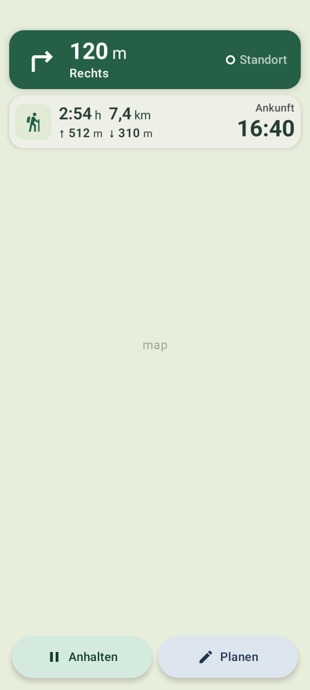
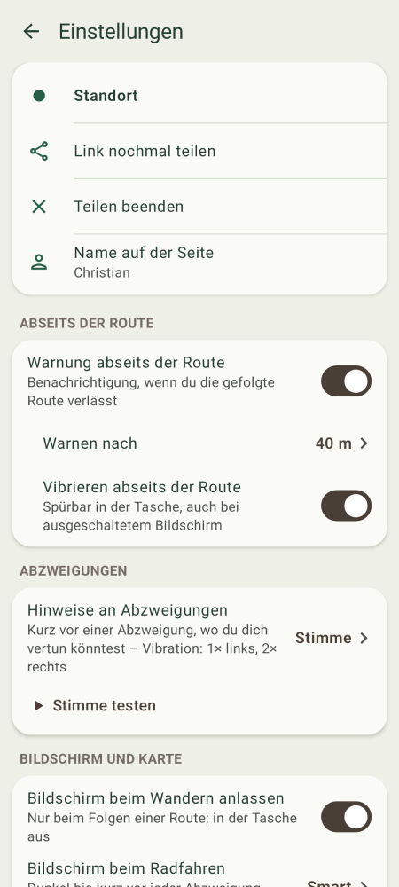
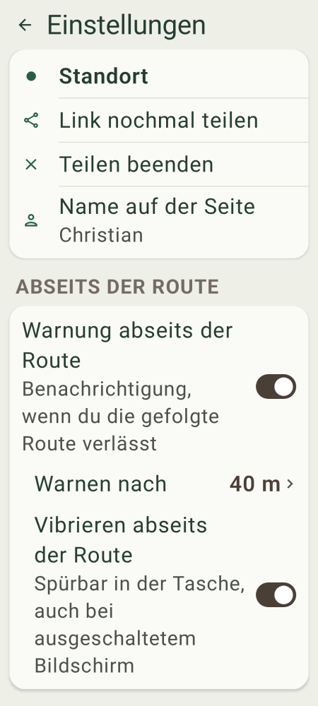
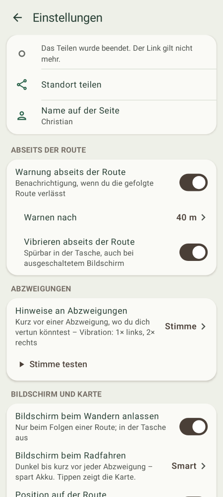

# Standort teilen – Bilder zum Ansehen (Stand 2026-11-20)

Bilder zum Entwurf `docs/design/live-tracking.md`, so wie es gebaut ist (Owner 2026-11-20: Zeichen C, „Ja, einbauen“, das
Wort ist „Standort teilen“ – kein „Live“). Die Karte ist auf den App-Bildern ein Platzhalter, Zahlen und Name sind erfunden.

## Das Zeichen in der Richtungskarte (Vorschlag C, gewählt)

| Geteilt | Wartet auf Netz | Freie Tour ohne Route |
| --- | --- | --- |
|  |  |  |

„● Standort“ am rechten Rand der grünen Richtungskarte: kein zusätzlicher Platz, die Abbiegeanweisung bleibt groß. Wartet
das Handy auf Netz, ist der Punkt hohl und das Wort blasser. Eine freie Tour hat keine Richtungskarte – dort steht eine
kleine Pille oben rechts. Ein Tipp auf das Zeichen öffnet „Link nochmal teilen“ und „Teilen beenden“.

## Standort teilen in den Einstellungen (⚙ während der Tour)

| Noch nicht geteilt | Geteilt | Geteilt, wartet auf Netz | Größte Schrift | Vom Server beendet |
| --- | --- | --- | --- | --- |
|  |  |  |  |  |

Erster Eintrag der Einstellungen, die sich in der Navigation öffnen – nur während eine Tour läuft. Ein Tipp auf „Standort
teilen“ öffnet (beim ersten Mal nach der Namensfrage) Androids Teilen-Auswahl mit „Verfolge meine Tour: ‹Link›“.
„Vom Server beendet“ (der Link lief nach 48 h ab o. Ä.): eine graue Zeile, bis man sie hier gesehen hat – nie ein Fenster
während der Tour.

## Namensfrage (einmal, vor dem ersten Teilen)

## Die Seite für die Familie

| Unterwegs | Pause | Abseits der Route |
| --- | --- | --- |
|  |  |  |

| Kein Kontakt | Tour beendet | Nicht mehr geteilt |
| --- | --- | --- |
|  |  |  |

Die echte gebaute Seite mit unserer Karte bei Meran; Zahlen, Uhrzeiten und Name sind erfunden.
