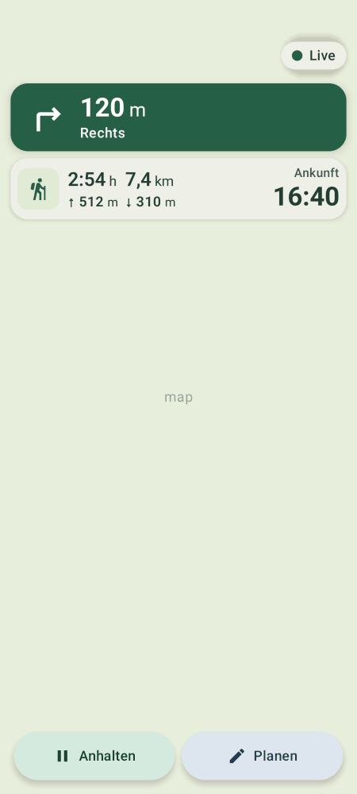
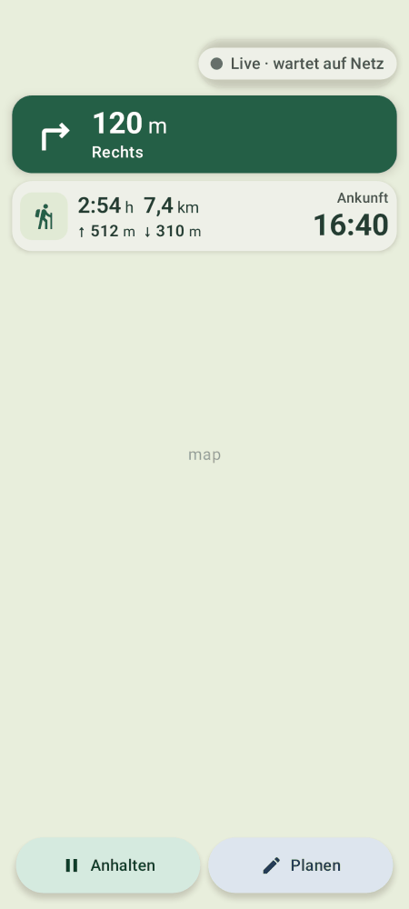
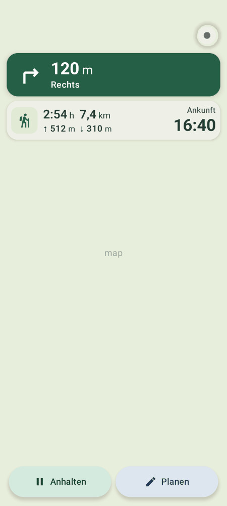
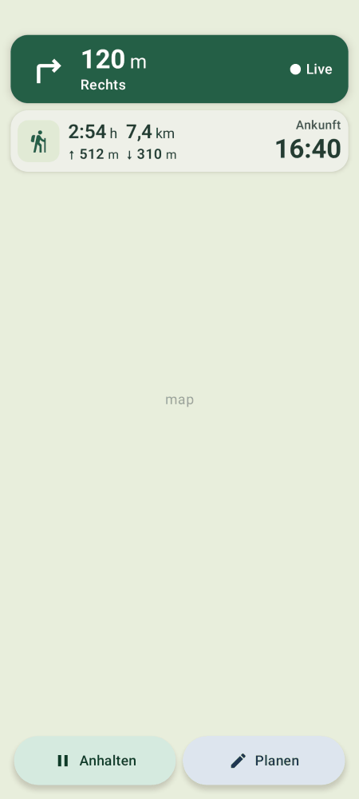
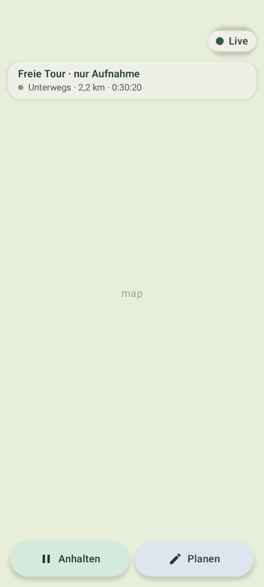
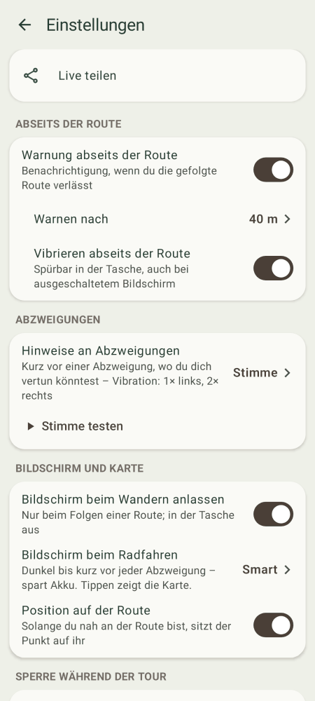
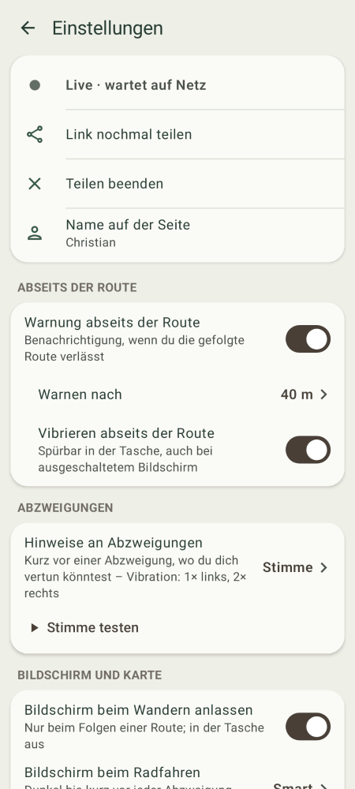
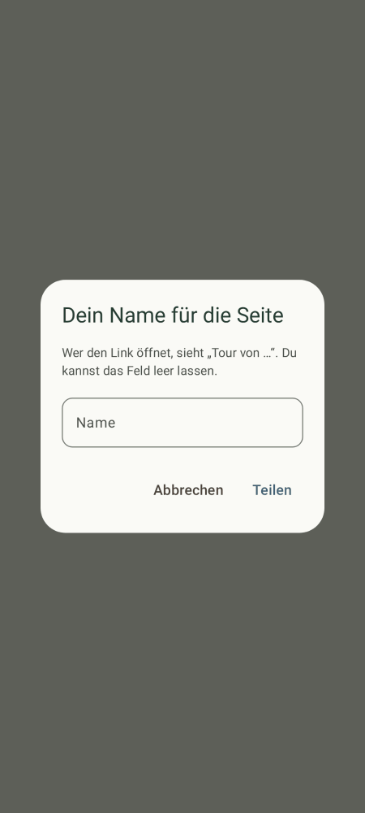

# Live teilen – Bilder zum Ansehen (Stand 2026-11-20)

Bilder zum Entwurf `docs/design/live-tracking.md`. Alles hier liegt auf dem Zweig `feat/live-share-ui` und ist noch
nicht in der App. Die Karte ist auf den App-Bildern ein Platzhalter, Zahlen und Name sind erfunden.

## Live-Zeichen – Vorschlag A: kleine Pille oben rechts

| Live | Wartet auf Netz |
| --- | --- |
|  |  |

Eigene kleine Pille über der Richtungskarte. Immer an derselben Stelle, auch ohne Route. Kostet eine schmale Zeile Karte.

## Live-Zeichen – Vorschlag B: nur ein Punkt oben rechts

| Live | Wartet auf Netz |
| --- | --- |
|  |  |

Am kleinsten. Grün = es wird gesendet, grau = wartet auf Netz. Ohne Wort muss man wissen, was der Punkt heißt.

## Live-Zeichen – Vorschlag C: in der Richtungskarte (Empfehlung)

| Live | Wartet auf Netz | Freie Tour ohne Route |
| --- | --- | --- |
|  |  |  |

„● Live“ am rechten Rand der grünen Richtungskarte: kein zusätzlicher Platz, die Abbiegeanweisung bleibt groß. Wartet
das Handy auf Netz, ist der Punkt hohl und das Wort blasser. Eine freie Tour hat keine Richtungskarte – dort steht die
Pille aus Vorschlag A. Ein Tipp auf das Zeichen öffnet „Link nochmal teilen“ und „Teilen beenden“.

## Live teilen in den Einstellungen (⚙ während der Tour)

| Noch nicht geteilt | Geteilt, live | Geteilt, wartet auf Netz | Größte Schrift |
| --- | --- | --- | --- |
|  |  |  |  |

Erster Eintrag der Einstellungen, die sich in der Navigation öffnen – nur während eine Tour läuft. Ein Tipp auf „Live
teilen“ öffnet (beim ersten Mal nach der Namensfrage) Androids Teilen-Auswahl mit dem Link.

## Namensfrage (einmal, vor dem ersten Teilen)

## Die Seite für die Familie

| Unterwegs | Pause | Abseits der Route |
| --- | --- | --- |
|  |  |  |

| Kein Kontakt | Tour beendet | Nicht mehr geteilt |
| --- | --- | --- |
|  |  |  |

Die echte gebaute Seite mit unserer Karte bei Meran; Zahlen, Uhrzeiten und Name sind erfunden.
