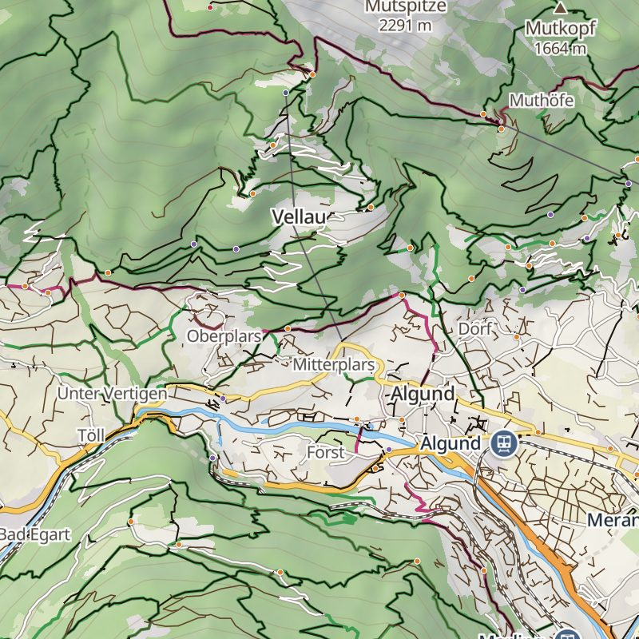
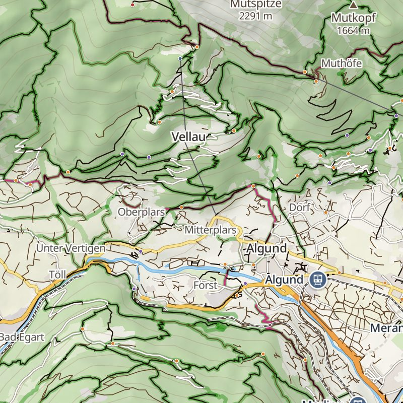
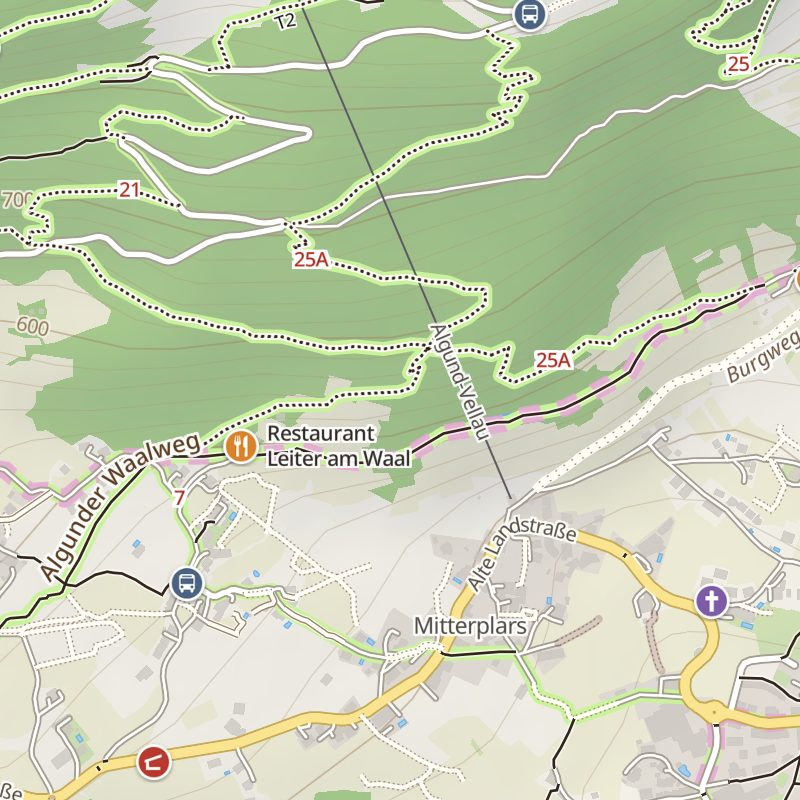
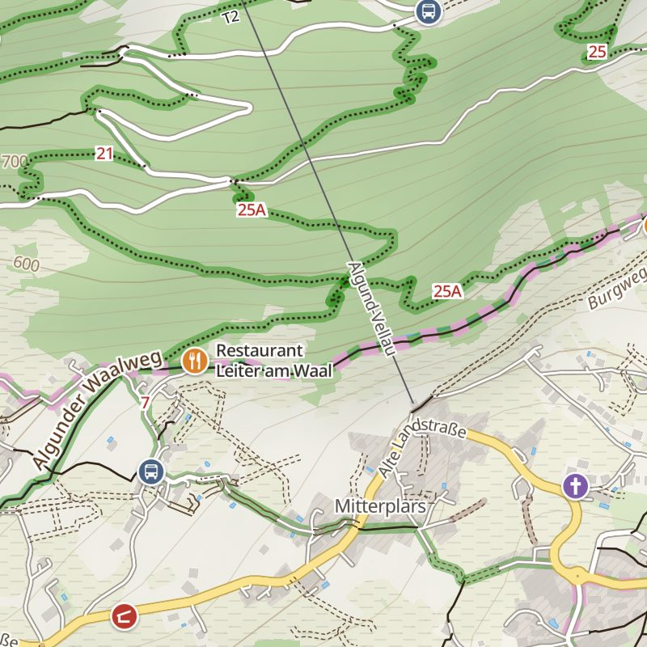
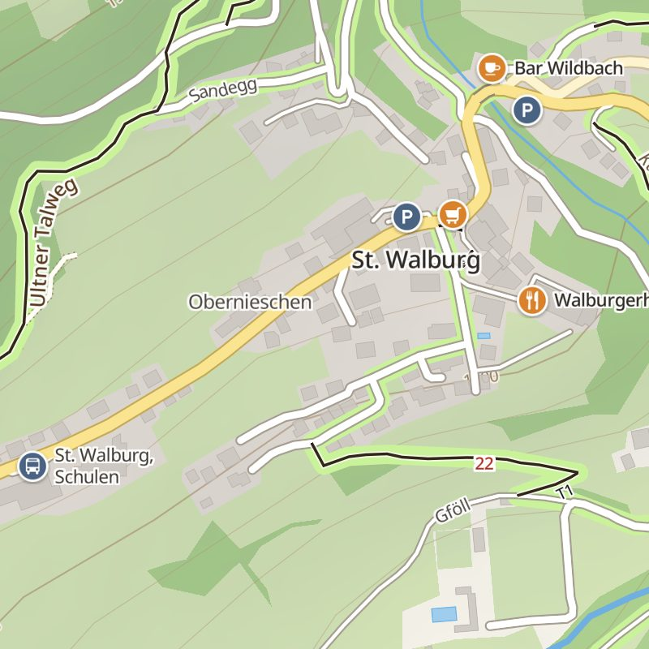
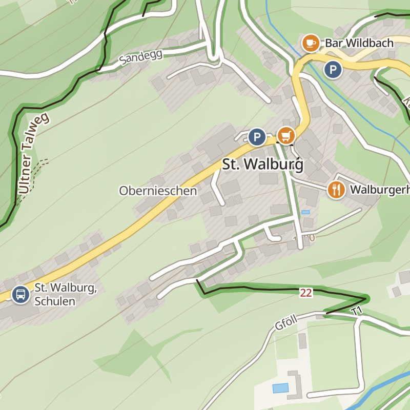
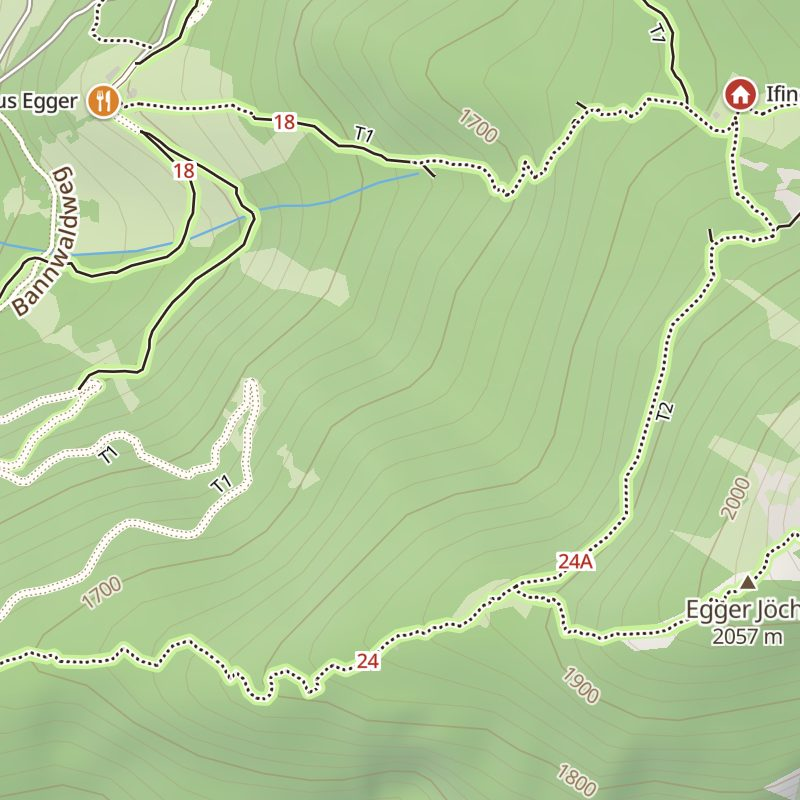
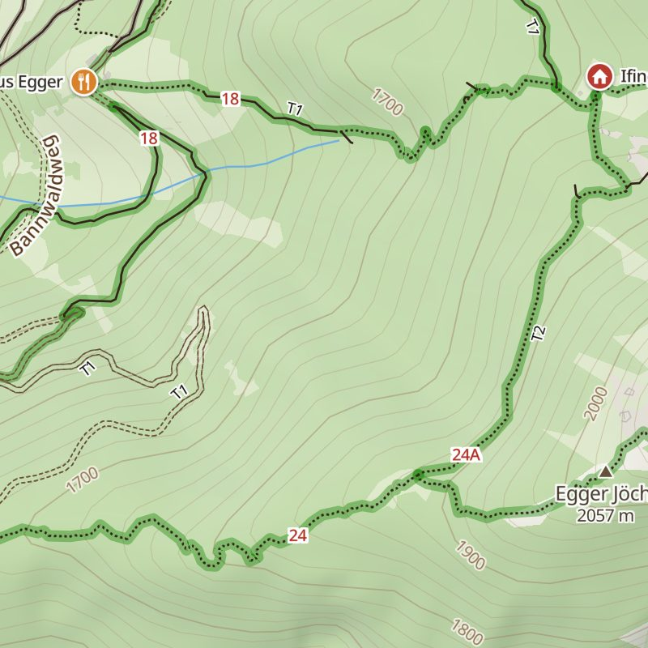

# Map colours: how the OnPath route band and ground colours were derived

Status: analysis done 2026-10-19 (owner + Claude, cloud session); built into the app in **0.7.0** (map package with paths.geojson).
Reproduce the numbers with `python3 tools/style_analysis/route_green.py`. The interactive matrix is
[`route-green-matrix.html`](route-green-matrix.html) (open in a browser).

## Why this document exists

OnPath's map style is our own. Some outdoor apps, Komoot among them, are well-known references for the general
*kind* of map hikers expect: black paths, dotted mountain trails, a coloured band along marked routes. Those are
long-standing topographic and Alpine-club map conventions, not something one app owns.

The concrete colours, opacities, widths and symbols in OnPath were **derived from our own analysis**. The analysis
used field-test feedback from the owner and a measurable contrast criterion, as recorded below. No colour values,
images, icons or data were taken from Komoot or any other app. The ground colours come from our own `classic`
theme (2026-10-17 onward). The route colour was chosen by an optimisation over our own ground colours.

## Starting point (field test, 2026-10-19, Ultental / Algund)

The owner tested 0.6.x on a hike and found the map too pale:

- **Route band hard to see on forest.** The route band was a light green `#c9f29b`, opaque from zoom 14, on forest `#a9cd8b`.
- **Route turned black at zoom 12.** There the route is a thin green line under the black path, so the path covered it.
- **Two styles were one too many.** "Normal" and "high contrast" should become one map that is fine *and* clear.

## Iterations and owner decisions

| Step | What was shown | Owner decision |
|---|---|---|
| 1 | Three full style proposals A/B/C (lighter forest, dark band edge, maximum contrast); renders z11–16 in three areas | **No edges on the band, ever.** Too many lines; only a slightly transparent band whose colour contrasts with the ground |
| 2 | Colour matrix: every ground colour × 10 greens, band without edge, path on top, colour difference per cell | Look at grounds and symbols too |
| 3 | Matrix v2: ground symbols (z14–16), no white anywhere in the path drawing | **No white casings or underlays** ("too nervous"). No symbols for normal forest and meadow. Symbol variant 1. Meadow in shadow should not look grey. Prefer a dark green at **lower opacity** |
| 4 | Matrix v3 with a computed optimum (below) | **Band #168403 at 40 %**; real map renders requested |
| 5 | Real renders (maplibre-gl, same tiles as the app) | **Residential: no hatch** (too busy when cycling through a town), a lighter neutral grey instead |

## Method

For every candidate green `G` and opacity `α`, the band seen on a ground colour `B` is the alpha composite
`C = (1−α)·B + α·G`. Two numbers are computed for every ground:

1. **Band visibility.** The CIEDE2000 colour difference ΔE00(C, B), which measures how differently a person sees
   the band and the bare ground. As a rule of thumb, ≥ 12 is clear at a glance and < 7 blurs on a phone.
2. **Path legibility.** The WCAG 2 contrast ratio between the path ink `#33251a` and the composited band `C`.
   ≥ 4.5 is very good (the WCAG text level); < 3 the black path starts to disappear in the band.

A hiker needs the band on *every* ground, so the score of a colour is its **weakest ground** (the minimum over
all grounds), not the average. The grounds are wood, grass, leisure, wetland, farmland, open land, residential,
rock, sand and ice. Wood and grass also appear "in hill shadow", i.e. mixed with the hillshade shadow colour.

The optimiser searches CIE LCh space: hue 120–150° (green), lightness 20–90 and chroma 20–84, about 5 000
colours. It keeps the colour with the largest weakest-ground ΔE00 among those whose path contrast stays above a
floor (3.5 or 4.5).

## Results (from `tools/style_analysis/route_green.py`)

Weakest ground at 40 % opacity:

| Green | Ground today, blue-grey shadow | Lighter ground, greenish shadow |
|---|---|---|
| light `#c9f29b` (until 0.6.9) | band 3.7 · path 7.5 | — |
| dark `#2e7d32` | band 8.3 · path 4.1 | band 10.4 · path 5.3 |
| **chosen `#168403`** | band 11.4 · path 4.2 | **band 12.4 · path 5.3** |
| very dark `#014e08` | band 14.3 · path 3.2 | band 16.0 · path 4.2 |
| optimum, path ≥ 4.5 | `#1aa200` band 10.3 · path 4.7 | `#06630f` band 14.2 · path 4.6 |
| optimum, path ≥ 3.5 | `#06630f` band 12.4 · path 3.6 | `#003a01` band 17.9 · path 3.8 |

Findings:

- **A dark green at low opacity is the right kind of band.** It shows because it darkens the ground a little and
  makes it greener. A light green barely differs from light forest: today's light green scored 3.7.
- **There is a trade-off.** A darker band is more visible, but the black path on it reads worse. No single colour
  maximises both.
- **The weakest ground is always forest,** usually forest in hill shadow. Making the forest lighter and the hill
  shadow greenish raises every candidate by about 1–4 points, more than most choices of green.
- **`#168403` at 40 % is a balanced choice.** On the lighter ground it is clearly visible (12.4) and keeps the
  path very legible (5.3). It is close to the computed optimum and stays saturated, so it reads as "green route"
  rather than "dark shadow".

Limits: these are screen colours (sRGB, ideal display). Sunlight and glare on the glass reduce all contrasts, so
the real map renders and a field test have the last word. Symbols and relief texture are not part of the numbers.

## Chosen style (now `tools/themes/classic.json`)

- **Route band:** `#168403`, 40 % opacity at every zoom, no edge. Route pieces are merged into continuous lines
  in the pipeline, so the transparent band does not darken where pieces meet. Only real junctions and tight
  hairpins overlap slightly.
- **Ground:** wood `#c3dcab`, grass `#dfeacb`, leisure `#d9e8c4`, farmland `#f1f0de`, land `#f6f4ec`,
  residential `#e6e5e1` (light neutral grey, no pattern; band 23.6 · path 7.0 on it).
- **Hill shadow:** greenish `rgba(45,68,45,0.40)` instead of blue-grey, so shaded meadow does not look grey.
- **Paths:** black lines only, no white casing, no light underlay. From z13.5 paths are drawn from our own exact
  path data (`paths.geojson`, pipeline change). A dotted mountain trail then no longer needs to hide a solid
  base-map line underneath.
- **Tracks (variant A):** two thin brown dashed edges (`line-gap-width`), no light fill. The ground and the band
  show through between them, and the double edge reads as a wider way than a path.
- **Ground symbols** from z14, as small `fill-pattern` tiles, very light:
  - wetland: marsh tufts
  - farmland: furrow dashes
  - rock: rock outlines
  - sand: dots

  None for forest and meadow (owner decision).
- **Cable-car ropes:** wider with zoom (1 → 3.2 px), like the railway. Already in the app style since 2026-10-19.

## Before / after (maplibre-gl render of the same map data)

| Before (0.6.9) | After (proposal) |
|---|---|
|  |  |
|  |  |
|  |  |
|  |  |

## Shipped in 0.7.0 (what was done)

1. **Pipeline:** `extract_overlays.py` writes `paths.geojson` (every path and track, exact geometry, `k`, `sac`,
   `vis`, steps flag) and merges route pieces per kind into continuous lines.
2. **Style:**
   - Move the proposal's post-processing into `make_style.py`:
     - own path layer
     - track variant A
     - symbol layers
     - 40 % route opacity
   - Make the chosen theme the only one and drop "high contrast".
3. **App:**
   - Add the symbol tiles at style load (`style.addImage`).
   - Remove the theme switch in Settings.
   - Add `paths.geojson` to `OptionalSources`.
4. **Field test** in sunlight.

## Road types: street, track, path (2026-10-19, proposal)

For hiking and cycling the key question is the surface. Is it a paved street, an unpaved track (forest or farm
road, `highway=track`, theoretically drivable) or a path? The owner rejected white street fills with a dark casing
as too busy. Four variants without any white were rendered
(https://claude.ai/artifact/JfUteXEasokSfqgJeCn8hq):

| Variant | Street (minor, service) | Track |
|---|---|---|
| 1 | solid grey line | grey dashed line |
| 2 | solid grey line | brown dashed line |
| 3 | two thin grey edges (open, no fill) | two grey dashed edges |
| **4 (recommended)** | two thin grey edges | brown dashed line |

The rule behind variant 4 is that every type gets its own **shape**, not only a colour, because colour differences
fade in sunlight:

| Type | Shape |
|---|---|
| street | double line, reads as "wide, paved" |
| track | dashed, reads as "not paved"; brown |
| path | thin solid black |
| mountain trail | black dots |

A solid grey street (1, 2) reads like a thick path. Grey double-dashed tracks (3) are too faint, and tracks matter
most for cyclists. Track quality from `tracktype` sets the dash length:

| `tracktype` | Dash |
|---|---|
| grade1–2 (compact) | long dashes |
| grade3 | medium dashes |
| grade4–5 (soft, grass) | short dashes |
| paved track | solid |

Decision pending (owner).

**Owner variant 5 (2026-10-19):**
- Street: two separate solid grey lines.
- Farm road: two dotted brown lines (round dots).
- Neither has any white. Both show through under the 40 % green band.

Renders show that it works well from z15. At z14 the two dot rows of a farm road move close together. There, a
single brown dashed line is suggested so that it cannot be mixed up with the single black dot row of a T2 trail.

**Track quality in the dots (variant 5, from z15).** Where OSM has a `tracktype` (61 % of the tracks in the test
area), the spacing of the dots shows the surface:

| Surface | Drawing |
|---|---|
| paved | two solid brown lines |
| grade1, compact | dense dots (dash 0.1 / 1.0) |
| grade2 or unknown | normal dots (0.1 / 1.7) |
| grade3 | wider dots (0.1 / 2.6) |
| grade4–5, soft or grass | sparse dots (0.1 / 4.0) |

Up to z14.5 a track is one brown dashed line. Tracks then come from our own `paths.geojson` (with `tt` and a paved
flag), like paths, so no base-map track line shows underneath.

## Quiet towns (2026-10-26, owner field report)

**Problem.** In towns the map was hard to read (owner, Düsseldorf and Hilden on the phone, 0.11.0):
- zoomed out (z11–13): hundreds of short near-black dashes – town footways from the coarse path copy and the base map;
- the street grid hardly showed: two dark grey edges around a near-white lane read as one grey line at z12–13;
- built-up land was nearly the colour of fields;
- in bike mode the 40 % cycle-route band and the pink long-distance dashes covered whole districts;
- in hike mode every town footway and sidewalk was a green line;
- path ends stopped a few metres before the street, at a sidewalk or crossing piece the map does not draw.

The hiking look in forests, meadows and mountains was fine and had to stay.

**Rule.** The map now knows where a way is in a town. The overlay attribute `u` is set by `extract_overlays.py`
(`TownIndex`):
- **`u = 1`, built-up:** inside residential / commercial / retail / industrial / railway / education landuse or a school
  or hospital area, grown by 25 m (landuse blocks often stop at the street), or in a dense block of buildings (≥ 8
  within ~120 m) where no landuse is mapped.
- **`u = 2`, town green:** park, garden, playground, pitch, cemetery, allotments.
- **Never set:** forests, meadows, fields and other open land win over both, and graded trails (T2+ or a faint trail)
  never get `u`.

Cells without `u` (built before schema 6) draw exactly as before.

| What | Before | Now | Why |
|---|---|---|---|
| Built-up land | `#e6e5e1`, 55 % at z9 → full at z13 | **`#e2e0db`**, full from z11 | Towns read as towns when zoomed out. ΔE00 to open land rises from 3.7 to 4.5; still light enough that the path ink keeps 11.2 : 1 on it |
| Industrial land | `#e0dadb` | **`#dcd8d6`** | one step below built-up land, as before |
| Town footways / paths / cycleways / steps (`u = 1`) | near-black `#33251a`, from z12 (base map) / z11 (coarse copy) | **mid-grey `#8e8780`**, thinner (0.9 / 1.4 / 2.2 px at z14 / 16 / 18), only from z14 (fade in from z13) | In a town every footway is walkable, so the line only has to say "there is a way". Grey keeps 2.7 : 1 on built-up land and 3.5 : 1 on a white street lane: readable close in, quiet zoomed out. ΔE00 34.5 to the dark path ink, so country and park paths still stand out where hiking starts |
| Town green (`u = 2`) | dark, from z11 | dark as before, but only from z13 | A cemetery or park path grid was a black mat at z11–12; close in, park paths are where people walk |
| Town streets (overlay `streets`, `u = 1`) | warm lane `#f9f7f1` 92 %, edges `#7d766d` | **white lane `#ffffff`**, a little wider (gap 1.9 / 2.6 / 4.4 / 8 px at z13 / 14 / 16 / 18), **light edges `#b8b2aa` → `#a39c93` → `#8f887f`** (z13 / 15 / 17) | The grid reads at a glance: the white lane has ΔE00 7.0 to built-up land (old lane 4.9), and light edges (1.6–2.7 : 1) frame it without drawing a dark line. Country streets keep the 0.7.0 look: pure white glared on hillsides (Meran test renders) |
| Small streets z11–12 (base map, no town flag) | gap 0.6 → 1.1 px, edges `#7d766d` 0.6 px | **gap 0.7 / 1.25 / 1.5 px** (z11 / 12 / 13), **edges `#958e85` 0.5–0.6 px**, lane `#fdfcf9` | A lane wider than its edges reads as a light street rather than a grey line. Kept modest because these zooms also show mountain farm roads |
| Pedestrian streets in town | dark line | **pale warm lane `#f1ebe0`** (2.6 / 6 / 14 px at z14 / 16 / 18); squares (`area=yes`) no outline at all | A walking street looks like a street you may walk on (ΔE00 3.8 to built-up land, 6.7 to a white street). A square's outline drew a thick ring around it |
| Path gap at sidewalks / crossings | gap of a few metres before the street | **link pieces `k = "l"`**: the hidden sidewalk / crossing piece from a loose path end to the nearest drawn way (≤ 30 m), drawn like the path (grey in town) | The path visibly reaches the street. Not drawn for detours (chain > 1.6 × the straight gap), for path pieces shorter than 20 m (spurs at traffic islands made small triangles) or towards another loose end |
| Hiking green line (`greenway-foot`) | on every town footway and sidewalk | not on town footways (`u = 1`) or squares; parks, country and cycleways outside towns as before | In a town every footway is walkable: the green said nothing and doubled the clutter |

**Bike activities** (the cycle-route view, owner 2026-10-26):

| What | Before | Now | Why |
|---|---|---|---|
| Signed cycle routes | 40 % band `#168403` (up to 17 px) + pink long-distance dashes | **thin teal line `#138a7c`** (0.8 / 1.0 / 1.3 / 2.0 / 2.6 / 3.6 px at z9 / 11 / 12 / 13 / 15 / 18), 55 % at z11, 65 % at z12, 90 % from z13 | Cycle-route networks are dense in cycling regions: bands covered whole towns. A thin line shows the network and leaves the streets readable. Lighter while zoomed out, where networks overlap most. 3.2 : 1 on built-up land, 3.1 : 1 on forest |
| National / long-distance routes (net ≥ 3) | pink line / pink dashes | **violet `#7a4bc4`** on top (1.1 → 3.8 px), 95 %, name in `#5a2f9e` | Long-distance routes stay findable inside the network: ΔE00 40 to the teal, 56 to the green ways; 4.4 : 1 on built-up land. Regional routes (net 2) are part of the teal network, with their name in `#0d5f55` |
| Ways good for the bike | thin green line `#2e9e3a` | the green line plus a **soft mint glow `#a9e4c6`** at 55 % (2.5 → 10 px) underneath; **roads with a cycle lane / track** get the glow beside the road (6 → 30 px, under the road casing); in town from z14 (fade in) | Shows at a glance where riding is pleasant, also on roads with a lane. Soft (ΔE00 14 on built-up land), so it never competes with the route lines. Later in towns, where bike infrastructure is everywhere |

**Forbidden ways** (owner 2026-10-26, Hilden industrial area: "forbidden tracks are super visible – normal streets
are smaller"):
- Rule: a forbidden marking is never wider or stronger than a normal street at the same zoom (`StyleFormatTest`
  checks the widths at z14–18).
- **The tint band is gone everywhere.** The old `rgba(120,70,70,0.28)` band was 4–12 px wide, wider than a minor
  street.
- **Paths / tracks**, which matter for hikers: the red dash `#c62828` stays (4.3 : 1 on built-up land), from z13; town
  paths only from z15. The no-entry sign is sparser: spacing 250 → 400 px instead of 90 → 160.
- **Private service roads and yards:** a thin muted dash `#b85c5c` at 85 % (0.7 / 1.1 / 1.4 px at z14 / 16 / 18,
  3.5 : 1 on a white lane), from z14. The sign shows only from z17, about once per way.
- **Private driveways / parking aisles** are not drawn below z17 at all. They had no marking before either, but drew
  as streets nobody may use.

Renders (private, not in the repo): Düsseldorf south z11.6–13, Oberbilk z14/15, Hauptbahnhof z17, Hilden centre z15/16,
Hilden industrial z15/16, Meran/Algund z12–16 (hiking look unchanged except village streets).

### Town streets: contrast and endings (2026-10-26, owner on 0.11.2, Hilden old town)

**Problem.** In the old town (Markt / Axlerhof, about z17) the owner said "the roads are very low contrast" and "clean up
the street endings – the green line and black lines go into the other street":
- pedestrian streets were a pale lane with no edge on the grey built-up land (ΔE00 3.8, 1.11 : 1) – they nearly vanished;
- white town streets had light edges (2.1 : 1 at z15);
- town footways and the bike green line ran on top of the street lane where they met it;
- a passage through a block of houses (`tunnel = building_passage`) was a solid line through the buildings.

**Rule.** In towns the street is on top: a way that meets it ends at its edge. Town streets and pedestrian streets get
a clear mid-grey edge close in. Zoomed out the quiet look stays.

| What | Before | Now | Why |
|---|---|---|---|
| Town paths, cycleways, steps, link pieces, bike green lines (`u = 1`) | above the street lanes | **below every road casing**: a `-town` copy of each layer (`make_style.py town_below_streets`, switched with its layer by `MapController.setOverlay`) | The street covers the path's end, so the path stops at the street's edge. Country and park paths keep their place above the lanes (hiking band under the path line, track and road junctions as before). Footbridges will stay on top once paths carry a bridge flag (`br`, pipeline item) |
| Passages / underpasses in town (overlay `tn`) | solid path line | **faint dashes** (1.5 / 1.5, 60 %), from z16 (fade in to z17) | A covered way is not a way across the roofs |
| Pedestrian streets in town | lane `#f1ebe0`, no edge | lane **`#f5ead5`** with a **mid-grey edge `#9a9184`** (0.8 / 1.2 / 1.7 px at z14 / 16 / 18) | The edge carries the street: 2.5 : 1 on built-up land, 2.6 : 1 on its own lane. The warmer lane tells it from a white street (ΔE00 10.0, was 6.7) |
| Town street edges | `#b8b2aa` → `#a39c93` → `#8f887f` (z13 / 15 / 17), 0.9 / 1.2 / 1.6 px | `#b8b2aa` → **`#928b82`** → **`#7d766d`**, 0.9 / **1.3 / 1.8** px (z14 / 16 / 18) | 2.65 : 1 at z15 and 3.7 : 1 at z17 on built-up land (was 2.1 / 2.65); 4.5 : 1 against the white lane. z13 unchanged, so the grid stays quiet zoomed out |
| Built-up land | `#e2e0db` | `#e2e0db` up to z14 → **`#eae8e3`** at z16 | Zoomed out towns still read as towns; close in the ground steps back so streets and buildings separate |
| Buildings | `#cbc6c0`, outline `#b2aba2` | **`#c6c0b9`**, outline **`#a9a197`** | 1.47 : 1 on the lighter ground (ΔE00 9.4, was 1.29 : 1, 6.2) |

The white lane itself has less contrast to the lighter ground (1.22 : 1, was 1.32 : 1) – on purpose: the edges frame the
street now, the lane only has to be the lightest thing on the map. Variants tried (private renders, Hilden / Oberbilk /
Hilden industrial / Meran / Algund at phone size): endings only; edges; edges + lighter ground (this one); bold edges
(3.2–3.8 : 1, the town grid looked like an outlined street plan at z15–16).

### Bike view: green line + route band (2026-10-26, owner on the phone, later the same day)

**Problem.** In bike mode the soft mint glow under good bike ways was too faint to notice, and the thin teal route lines
said little at a glance.

**Rule.** Bikes get the same two layers as hiking:
- a **green line** marks a way good for the bike (the activity's router class 0 on paths, and cycle lanes / tracks
  beside a road);
- a **band** marks a signed route.

| What | Before | Now | Why |
|---|---|---|---|
| Good bike way | green line `#2e9e3a` (0.9 / 2.2 / 3.8 px at z13 / 16 / 18) + mint glow `#a9e4c6` 55 % | green line only, **1.2 / 2.8 / 4.4 px** | One clear mark, a little stronger than the hiking line because bikes read the map at speed |
| Cycle lane / track beside a road | green offset line 1.0 / 1.8 / 2.6 px (z14 / 16 / 18) + glow | **1.4 / 2.4 / 3.4 px**, no glow | Reads as "this road has a lane" without the haze |
| Local / regional signed cycle route | thin teal line `#138a7c` | **mint band `#a3e6c4` under the way**, below the road casings, 16 / 22 / 36 px at z15 / 16 / 18; 35 % at z9, 50 % at z12, 75 % from z15 | Like the hiking band, but under the street: a town street stays white and readable, the band shows on both sides. Light zoomed out, where networks in cycling regions are dense |
| Long-distance route (net ≥ 3, national / EuroVelo) | violet line `#7a4bc4` | **the hiking major-route look**: green band + pink dashes, thin pink line below z13.5, name | One look for "a long-distance route" in every activity |

A stronger variant (`#8fe8bd`, 20 / 28 / 44 px, up to 90 %) was rendered beside this one for the owner's choice on the
phone (private renders: Hilden, Oberbilk, Düsseldorf z12–14).

**Second look the same day (owner, Hilden south-west and the Karnaper Busch forest):**

| What | Before | Now | Why |
|---|---|---|---|
| Route band position | below the road casings | **above the casings, below the lanes**: a street on a route gets a mint border | On a wide main road (Düsseldorfer Straße) the band below the casing hardly showed |
| Band strength | `#a3e6c4`, 16 / 22 / 36 px, up to 75 % | **`#8fe8bd`, 20 / 28 / 44 px (z15 / 16 / 18), up to 90 %** | The owner's choice on the phone |
| Tracks, bike activities | dashed / dotted dark-brown edges, the same as hiking | **a light lane with thin grey-beige edges `#a89b88`** (0.5 / 0.8 / 1.1 px), lane by grade: compact `#fdfaf3`, medium `#f5ecda`, loose `#eedfc2`, soft `#e8d6b2` | In a forest the brown edges and the wide loose-surface halo were the strongest lines on the map. The road / gravel difference stays: a paved track is white with street edges |
| Loose surface, bike activities | wide brown edge `#b7793d` beside the path from z13 | **thin dotted brown edge from z15** | Still there when it matters (close in), quiet when planning |
| Closed path / track, bike activities | red dash `#c62828` 1.0 / 1.6 / 2.4 px | **muted `#b85c5c`, 85 %, 0.8 / 1.2 / 1.6 px**, signs as before | Still clearly "no", but never the strongest line in the forest. Hiking keeps the clear red dash |

Hiking keeps its look in every row (`-hikeview` layers; pixel-checked renders of Algund and the forest).

**With schema 7 cells (same day):**
- Route names along the band: dark green `#0d5f55`, 10–12 px, beside the band. They are placed before street names,
  otherwise a phone screen showed none.
- Bicycle streets (Fahrradstraße) get the green "good for the bike" line.
- Town footbridges stay above the streets they cross.
- Unsigned "networks" (for example `network=bcn`) no longer draw a route band (pipeline).

### Overview when zoomed out (2026-10-26, owner, every activity)
- Up to z13.5 the map shows the signed routes as thin solid lines (1.0 / 1.6 / 2.2 px at z9 / 12 / 13.5):
  - cycle routes in dark green `#1f7a5a`, on top of the streets;
  - hiking routes in their own green;
  - long-distance routes as the thin pink line.
- Path, track and trail lines are hidden for bikes and faint (35 %) for hiking. In the mountains the trail network off
  the signed routes is what a hiker plans with; with paths hidden, Meran / Algund showed almost nothing between the routes.
- The green good-way lines are faint (35 %) for both activities.
- From z13.5 to z14.5 everything fades into the close-up look.
- Why: zoomed out, the dense path network and the soft bands hid the route network. The overview shows the signed
  routes first.

### One-way arrows, forbidden ways, street space, underpasses (2026-10-26, owner on the phone)
| What | Before | Now | Why |
|---|---|---|---|
| One-way for everyone | small grey arrow `#5a5a5a` | **dark arrow `#262626`**, white outline, a little bigger | Reads on white streets, yellow / orange roads and black paths alike |
| One-way for cars, bikes both ways | two small half arrows | **green two-headed arrow `#1f8a32`** with white outline, also on small streets | The owner's rule: green = what the bike may do; it had shown only on a few ways |
| One-way only for bikes | – | **green single arrow** | Completes the rule |
| Forbidden dash | `#b85c5c` 85 % (bikes), `#c62828` (hiking) | bikes `#c46a6a` at 55 %, hiking 80 % | "They look too important": a closed way never stands out more than a usable one; hikers keep a clearer mark |
| No-entry signs | from z15, every 250–400 px | **0.7× size, 70 % (bikes) / 85 % (hiking), about once per way, from z16** (service roads z17) | Still says "no", without dotting a yard with red |
| Street space (z16+) | – | pedestrian areas / squares / islands / platforms `#f1ebdc` with a `#a89b88` outline; sidewalk / crossing lines `#9a9184` 0.6–1.0 px | A junction reads like a plan (Hagelkreuz in Hilden); data from schema 7 cells |
| Underpass | faint grey dashes (like a passage through a building) | **clear path line with thin dashed tunnel edges** above the railway | An underpass at a station is an important way, a building passage is not; needs the pipeline's `tn = "t"` |

### Region view: routes by zoom (2026-10-26, owner)
Zoomed out to a region, every signed route at once (local loops, town networks) hid the few routes that matter at that
scale. The map now shows them in tiers, the same for hiking and bikes:
- long-distance routes (national, EuroVelo, long-distance hiking) at every zoom, as the pink line;
- regional routes from z11: the thin green overview line (bikes dark green, hiking the band green);
- every signed route from z12.5.

### Greener region view, pink long-distance routes (2026-10-26, owner on 0.11.4 over Düsseldorf – Köln)
"The landscape doesn't look green at all zoomed out – it looks like there is no nice area to walk" and "bike roads
zoomed out are red, very similar to streets". Three rounds of renders and phone tests (r1 calm, r2 stronger, r3 / r3b
after the owner's look at r2); shipped as r3b.

| What | Before | Now | Why |
|---|---|---|---|
| Open land z7–12 | pale background / near-white region relief (`#fffff4`), farmland `#f1f0de` | **green veil `#c8e0a6`**, 60 % up to z9 → 25 % at z12 → 0 at z13 | Region packages drop farmland at z7–9, so open land was the pale background; the veil also softens the grey relief |
| Forest | `#cde3b8` up to z12 | **`#a9d789` at z8** → `#c1e3a5` z12 → today's tone at z13 (all a step greener: z15 `#d4edbf`) | A clear, slightly deeper green zoomed out, not neon |
| Meadow / park | `#e3edd2` up to z12 | **`#c4e7a5` at z8** → `#e2f0cf` z13 (z15 `#e6f2d7`) | Green areas read as green at every zoom |
| Towns | residential 60 % at z9 | 90 % at z9; residential / industrial ~4 % darker close in (`#d9d7d2`, `#d3cfcd`) | Towns stay grey on the greener land; white streets still stand out, buildings stay a step darker |
| Long-distance routes zoomed out | raspberry `#c43a7d`, 1.2–2.6 px | **pink-violet `#c02fb0`**, 2.2 px z7 → 3.2 px z11, thin white halo | Clearly not a road colour (roads are yellow / orange / brown), reads on roads and towns |
| Which routes are pink | hiking: regional and long distance | **long distance only (net ≥ 3)**, hiking like bikes | Pink zoomed out = exactly the routes with the pink-green band close in |
| Main roads below z10 | casing colour (`#b38a2c` …) | lighter brown `<col>.low`, a little thinner to z11 | Calmer region view, the routes stand out |
