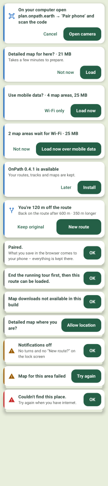
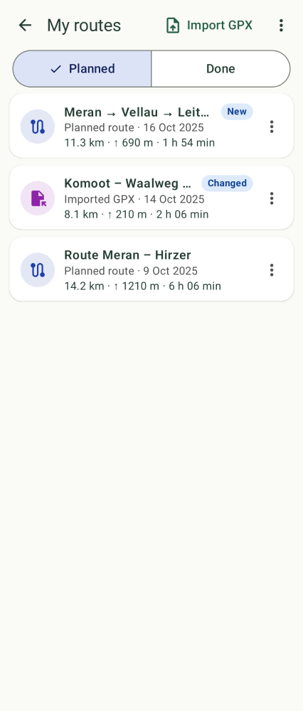

# OnPath UI style guide

The one place for how OnPath's screens look and talk. New UI follows it; a change to a rule is made here first
(owner decision), then in the code. Owner-approved 2026-10-31 (message system, mock style B).

## Principles
- **Light and calm:** white cards over the map, a light page background (`Paper`), dark green-grey text (`Ink`).
  No dark bars, no dark boxes – the two dark exceptions are the Navigate slide switch and the rest view while cycling.
- **Few colours, one meaning each:** green = act (primary button), blue edge = a question, amber = attention,
  red = something failed. Map furniture (route blue, track purple, recording orange) never appears in messages.
- **Nothing disappears by itself** (owner rule for the whole app – rain, stress): a box stays until it is answered,
  a state shows until it no longer holds. Nothing may flash (`NoFlash`).
- **Big targets:** gloves, one hand, sunlight.

## Colours (`ui/Theme.kt` → `OnPathColors`)
Colours come only from `OnPathColors` (and the Material scheme built from it in `Theme.kt`); no hex values in screens.

| Token | For |
| --- | --- |
| `Green` | primary buttons (filled, white text), text buttons, selected things; the brand colour of onpath.earth |
| `GreenLight` | light olive container: selected picker row, "easy" badge |
| `Ink` | text on light surfaces; message titles |
| `InkMuted` | secondary text: detail lines, explanations (Material `onSurfaceVariant`) |
| `Paper` | page background (My routes, Settings) |
| `CardWhite` | cards over the map (message boxes, sheets), text on `Green` |
| `InfoBlue` | the left edge of a **FRAGE** box (a question) – never a status or a failure |
| `TagContainer`, `TagInk` | a **tag** (light blue pill, dark blue word): the state of an item – "New" / "Changed" in My routes |
| `Grey` | the left edge of a plain **HINWEIS** box; grey icons |
| `Warn` (+ `WarnContainer`, `OnWarnContainer`) | **attention**: ⚠ + amber edge, route warning lines, the off-route card, a weak state |
| `Error` (+ `ErrorContainer`, `OnErrorContainer`) | **error**: ⚠ + red edge, red error lines, delete buttons |
| `Good` | "ready ✓", "up to date" |
| `Route`, `Gpx`, `Rec`, `Position`, `PositionUnsure`, `Weak` | map furniture only (planned line, GPX track, recording, own position, GPS dot) |
| `RestBackground`, `RestInk`, `RestDim`, `OnDarkMuted` | the rest view while cycling and the dark slide switch only |

Add a token when a new meaning is needed (with a comment saying what it is for); `inverseSurface` and Snackbars stay
out (`NoticesTest.noDarkBarAnyMore`).

## Type scale (`OnPathType`)
Five steps, all `sp` (the phone's font size applies): **12 / 14 / 16 / 22 / 30**.

| Size | Style | For |
| --- | --- | --- |
| 12 | `labelSmall` | map furniture: scale bar, ©, profile axes / legend; tags (bold) |
| 14 | `bodySmall`, `bodyMedium`, `labelMedium` | detail lines, subtitles, settings explanations, chips |
| 16 | `bodyLarge`, `titleSmall`, `titleMedium`, `labelLarge` | message titles, dialog text, list titles, buttons |
| 22 | `titleLarge` | plan sheet time, screen titles, Navigate time · distance, "Off route" |
| 30 bold | `headlineMedium` | Navigate turn distance, arrival clock |

Nothing a hiker must read is below 14. No hand-set `fontSize =` in `ui/` (`FontSizeRuleTest`); weight may be set.

## Buttons
- **48 dp minimum** height and touch target everywhere; **56 dp** for the buttons of a Navigate question (re-route,
  activity switch) – on the move, with gloves.
- **Verb labels:** "Take new route", "Load", "Install", "Try again" – not "Yes" / "No" (except where the question names
  the verb: "Off route – re-plan?" → Yes).
- **One primary button** per box / sheet: filled `Green` with white text. The others are green text buttons.
- Label style `labelLarge` (16 sp); the primary one bold.

## Dialogs
Only for decisions that can **lose something** (delete, replace an unsaved plan, end a tour, unpair). Verb buttons,
a title that asks, no body that repeats the buttons. A tap outside does nothing where it could lose work; Back =
the safe choice. Everything else is a message box or a line (below).

## The message system: exactly three kinds

| Kind | What | Look | Goes away |
| --- | --- | --- | --- |
| **FRAGE** (question / decision) | the user must choose | box, **blue** edge, title (+ one detail), **two verb buttons** (three only for "re-plan via the stop?") | when answered |
| **HINWEIS** (must know) | the user must see it once | box with **one** button: OK or the one way out ("Try again", "Allow location") | when the button is pressed (never by itself) |
| ↳ plain | | **grey** edge | |
| ↳ ⚠ attention (`HINWEIS_WARN`) | something needs care | **amber** edge + amber ⚠ | |
| ↳ ⚠ error (`HINWEIS_ERROR`) | something the user asked for failed | **red** edge + red ⚠; what failed + one way out | |
| **ANZEIGE** (state, nothing to do) | shows how things are | **no box**: a line or card in place | when the state no longer holds |

### The box: `MessageCard` (style B)


(German: `…MessageCardGermanScreenshotTest_kinds.png`, largest font: `…MessageCardLargeFontTest_kinds.png`.)

- White card (`CardWhite`), shadow elevation 6 dp, 16 dp corners, a **4 dp coloured left edge** (kind colour).
- ⚠ icon only for attention / error, in the edge colour. A question may carry a meaning icon (U-turn, activity).
- Title 16 sp bold `Ink`; at most one 14 sp detail (`InkMuted`). A one-sentence-plus text is split at the first ". "
  into title + detail (`Messages.split`).
- One button: beside the text (on its own row at a large font). Two or more: their own row, right-aligned, last =
  primary; they wrap when they do not fit.
- Code: `ui/MessageCard.kt` – `MessageKind` (FRAGE, HINWEIS, HINWEIS_WARN, HINWEIS_ERROR), `Message` (kind, title,
  detail, buttons, icon, tap), `MessageCard(message)`, `Messages.pick(candidates)`, `MessagePlacement`.

```kotlin
val m = errorMessage(Txt.s(Res.string.msg_shared_place_not_found)) { vm.errorCard = null } // split into title + detail
MessageSlot(Messages.pick(listOf(question, m)), MessagePlacement.topDp(MessageScreen.PLAN, 0))
```

### Which kind? (situation → kind → example)

| Situation | Kind | Example |
| --- | --- | --- |
| Mobile data needed for map areas | FRAGE | "Use mobile data? · 3 map areas, 25 MB" – Wi-Fi only / Load now |
| App opened where no detailed map is | FRAGE | "Detailed map for here? · 21 MB" – Not now / Load |
| Areas wait for Wi-Fi, Settings says Wi-Fi only | FRAGE | "3 map areas wait for Wi-Fi" – Not now / Load over mobile data |
| A new app version | FRAGE | "OnPath 0.4.1 is available" – Later / Install |
| Off route, a way back found | FRAGE (56 dp) | "Off route – new route found" – Keep original / Take new route |
| Activity switched during a tour | FRAGE (56 dp) | "New route for MTB" – Keep original / Take new route |
| First ☰ → Pair with browser | FRAGE | "On your computer open plan.onpath.earth …" – Cancel / Open camera |
| A planned route tapped during a tour | HINWEIS | "End the running tour first, then this route can be loaded." – OK |
| Paired / unpaired | HINWEIS | "Paired." + what it means – OK |
| No map downloads in this build | HINWEIS | OK |
| The map needs the location | HINWEIS | "Allow location" |
| Notifications off during a tour | HINWEIS_WARN | "Notifications off" + lock screen line – OK (tap = setup step) |
| Map areas could not be loaded | HINWEIS_WARN | "Map couldn't be loaded" – Try again |
| An error without a screen of its own (background, link / share into the app) | HINWEIS_ERROR | "Couldn't find this place." – OK |
| Route state | ANZEIGE | plan sheet lines (red ERROR, amber WARNING, grey INFO), "Saved as …", "New route · was 13:15" |
| Off route, finding the way back | ANZEIGE | the amber off-route card with the arrow (Navigate) |
| Downloads in the background | ANZEIGE | the small "⬇ Bozen · 34 %" chip; offline / waiting for GPS → the quiet grey pill |
| The result of an action in My routes / Settings | ANZEIGE | `NoticeLine`: grey INFO / red ERROR line at the top, gone when the screen is left |
| Work the user started | ANZEIGE | a spinner where it was started (`Busy`) |

### Common rules
- **One box at a time:** a FRAGE wins over a HINWEIS; the others wait in their state and come next
  (`Messages.pick`, unit-tested).
- **No dark message bar.** A result goes where the user acted: `vm.say(text, NoticeKind, NoticePlace)` →
  `NoticeRouting`: a grey / red line at the top of My routes or the open Settings page (gone when that screen is left);
  an ERROR without such a place → the HINWEIS_ERROR box (`vm.errorCard`); an INFO without a place → problem log only
  (`NoticesTest`). A result visible anyway is not said (no "Track saved to My routes").
- **No double question:** while the app is on screen, the off-route / re-route question is not posted as a heads-up
  notification – it goes on the quiet navigation channel (lock screen keeps it); heads-up only when the app is not on
  screen (`TourChannels.forQuestion`, `AppVisibility`).
- Progress = a spinner where the user started it, never a message.

## Tags
A tag is the **state of an item** in one short word, in a light blue pill after the item's name: "New" / "Neu" (came
from the browser, not opened yet) and "Changed" / "Geändert" (changed in the browser since it was last opened) in
My routes (owner 2026-10-31).



(German: `…GermanScreenshotTest_toursFromBrowser.png`, largest font: `…RouteTagLargeFontTest_toursFromBrowser.png`,
`…RouteTagLargeFontGermanTest_toursFromBrowser.png`.)

- **Look:** `TagContainer` pill (fully rounded), `TagInk` text, 12 sp bold (`labelSmall`), 8 dp side padding – one
  colour family for every tag (the info blue family; never amber / red / green: a tag is not a warning, not a failure
  and not a button). Code: `ui/RouteTag.kt` – `Tag(text)`, `TitleWithTag`, `RouteTitle(name, RouteTag)`.
- **Place:** on the title row, 8 dp after the name. The name ellipsizes before the tag is cut; when the name would keep
  less than 55 % of the row (largest font) the tag goes under the name (`TagRow.sameRow`, unit-tested). Never cut.
- **One word**, at most one tag per item; no tap of its own (the row's tap opens the item).
- **Goes when the state no longer holds** (here: the route was opened – `SyncMarks`), never by a timer.
- **Use a tag** for a lasting state of one item in a list that the user should spot while scanning (new, changed).
  **Not** for: something to do (→ a FRAGE box or a button), something wrong (→ an amber / red line), a count or a
  number (→ the detail line), a kind of item (→ the icon in the circle), or the result of an action (→ `vm.say`).
  No bold titles or extra grey lines to mark a state – that is what the tag is for.

## Positions per screen
Boxes (FRAGE, HINWEIS) always sit **12 dp under the top element** (`MessagePlacement`, one rule, unit-tested),
12 dp from the sides:

| Screen | Top element | Box top (below the status bar) |
| --- | --- | --- |
| Plan | search pill + ☰ row (`TOP_BAR_BOTTOM` 76 dp) | 88 dp; the plan sheet is drawn over it, so it never covers the primary button |
| Navigate | turn card / status card column (measured) | column height + 12 dp – the re-route and activity-switch questions too (moved from the bottom) |
| My routes | title row + Planned / Done tabs (112 dp) | 124 dp, over the list |
| Settings | title row (64 dp) | 76 dp, over the page |

While a box shows in Plan, the download chip and the quiet pill (both ANZEIGE) wait. Hints below the search bar
(shared place lookup, "Overview only") go below the box.

## Rules for new UI
- A question or must-know message → `Message` + `MessageCard` through the screen's host (Plan:
  `PlanMessageHost` in `MapScreen.kt`; Navigate: `NavigateOverlay`; My routes / Settings: `ScreenMessageHost`) – never
  a new strip, chip or card look. Add the candidate in the host's list; `Messages.pick` does the rest.
- A result → `vm.say(…)`; a state → a line where it belongs (plan sheet, screen top), no box.
- Buttons: Material `Button` / `TextButton` in `Green`, ≥ 48 dp. Sheets / cards: white, 16 dp corners.
- Texts: every user text EN + DE in `strings/…/composeResources/values[-de]/strings_<area>.xml`, used via
  `str(Res.string.x)` in Compose / `Txt.s(…)` elsewhere (`docs/i18n.md`). Short: a title ≤ 6 words where possible,
  one detail line. Diagnostics, Developer tools and the problem log stay English.
- Check the look with Paparazzi (EN, DE, largest font 2.0): nothing cut, buttons fit.
