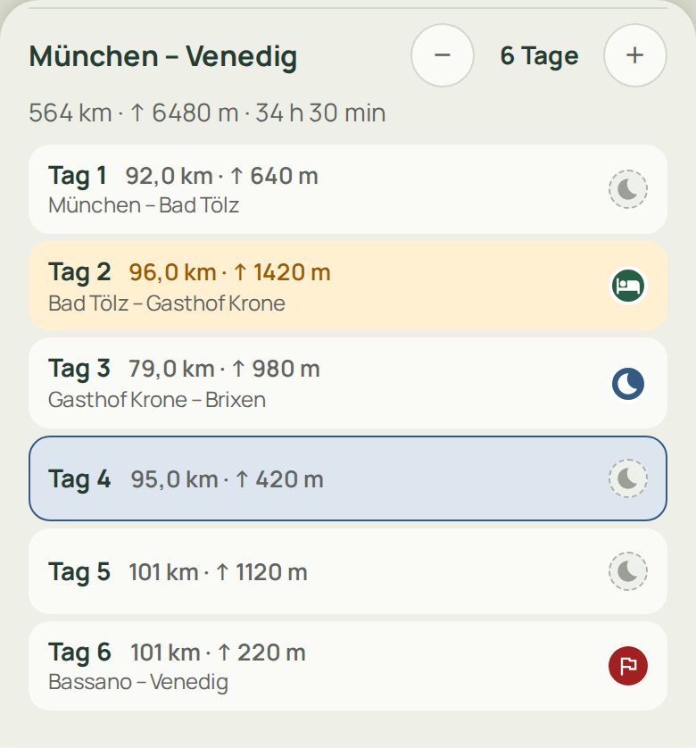
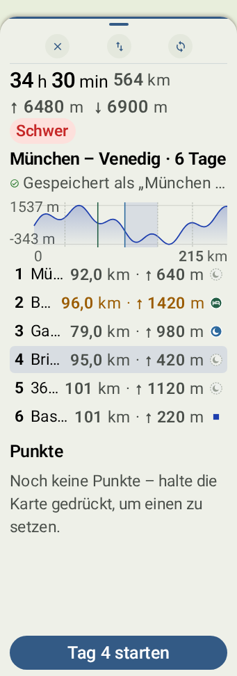
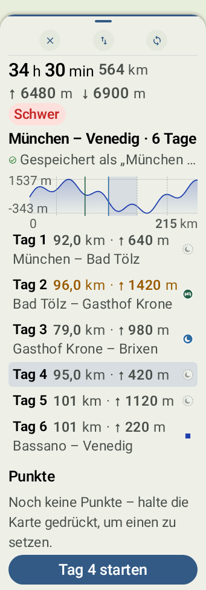
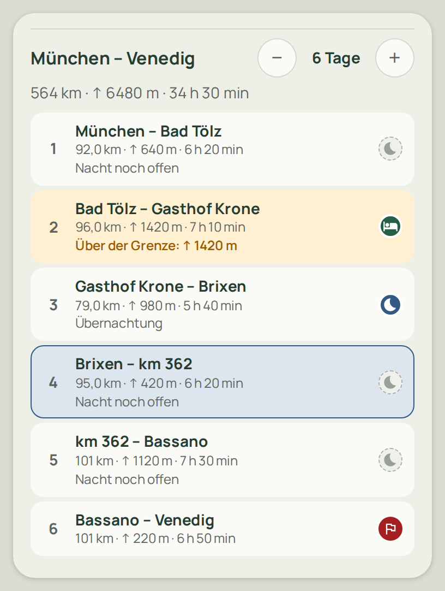
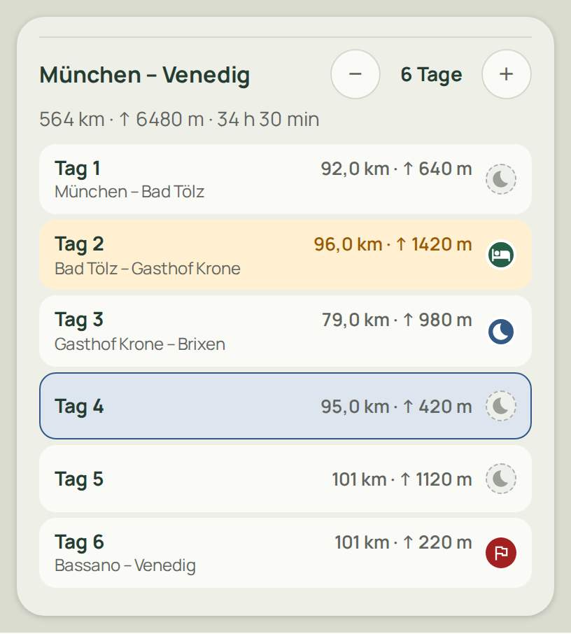
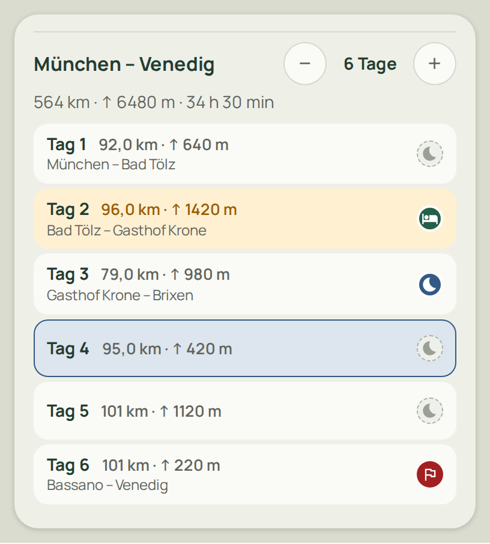

# Tage-Liste einer Mehrtagestour

**Mein Vorschlag: A.** Die Werte stehen untereinander, so lassen sich die Tage am schnellsten vergleichen.

Beispiel München – Venedig, Tag 4 ist angetippt. Bei Tag 4 und 5 liegt an einem Ende kein Ort in der Nähe, dort bleibt die graue Zeile weg.

## App

### Heute

### A – Werte rechts

### B – Werte neben „Tag 1“

## Planer

In A und B fehlen hier die Zeit pro Tag und die Zeile „Nacht noch offen“ / „Über der Grenze“, damit er aussieht wie die App. Ob das so bleibt, frage ich danach extra.

### Heute

### A – Werte rechts

### B – Werte neben „Tag 1“

Mehr: größte Schrift in der App, Planer am Computer

### App, größte Schrift: Heute

### App, größte Schrift: A

### App, größte Schrift: B

### Planer am Computer: Heute

### Planer am Computer: A

### Planer am Computer: B

