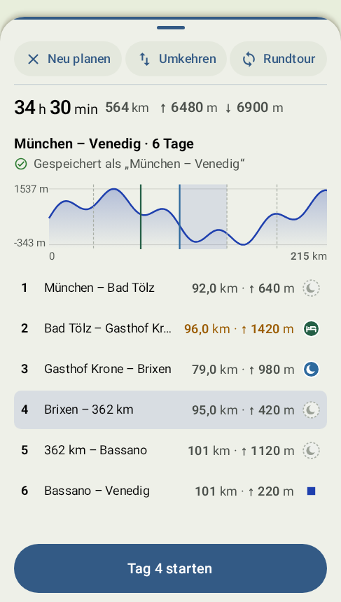
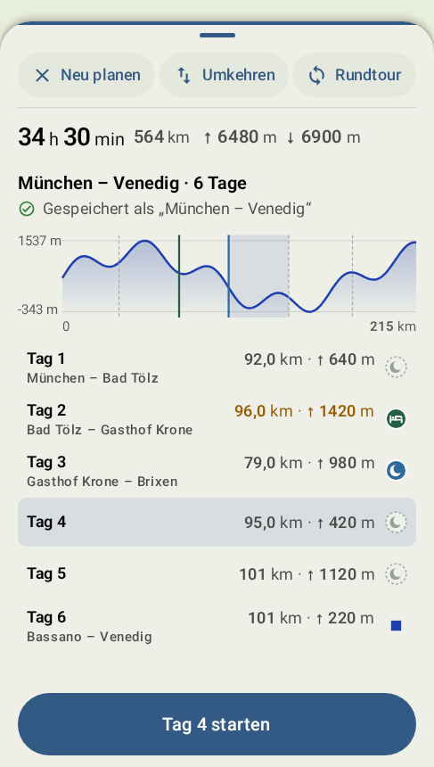
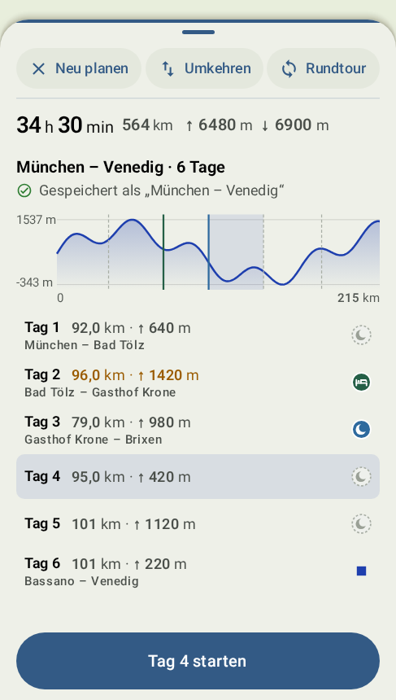
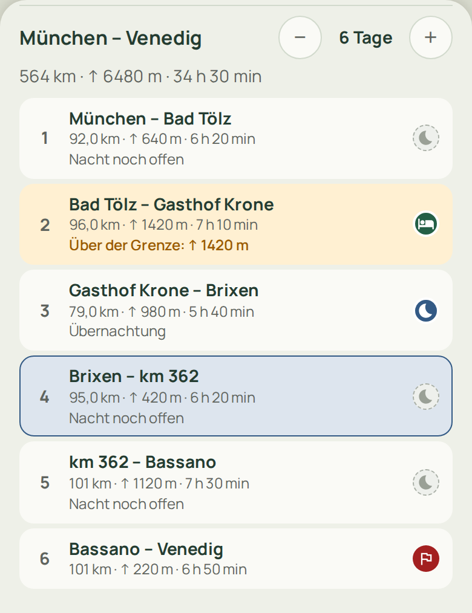
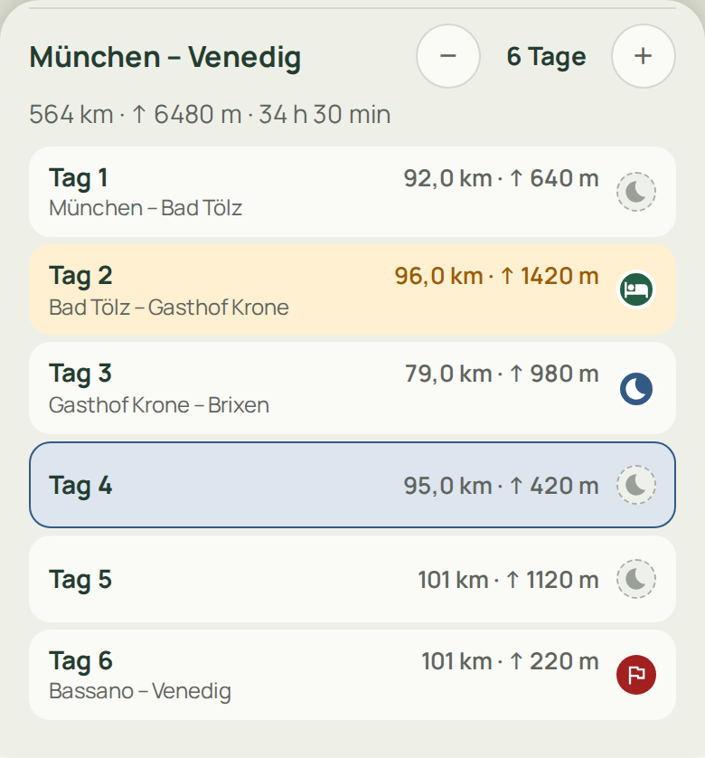
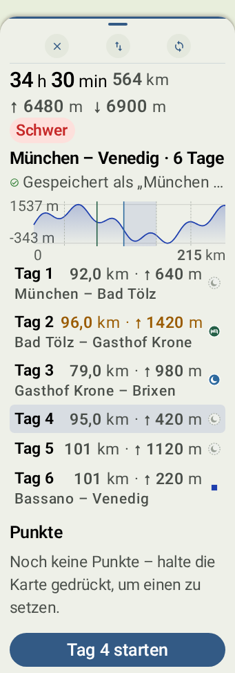

# Tage-Liste einer Mehrtagestour – drei Bilder

Beispiel: München – Venedig, 6 Tage, Tag 4 ist angetippt. Tag 4 und Tag 5 haben an einem Ende keinen Ort in der Nähe, dort steht keine graue Zeile.

## Im Handy

### Heute

Wie jetzt: Nummer, „von – nach“, Werte rechts. Fehlt ein Ort, steht der Kilometer.

### A – Werte rechts

Tag und Länge/Höhenmeter in einer Zeile, die Werte rechts am Rand; darunter grau „von Ort – nach Ort“.

### B – Werte daneben

Tag und Länge/Höhenmeter direkt nebeneinander; darunter grau „von Ort – nach Ort“.

## Im Planer, Handy-Breite

### Heute

Wie jetzt: Nummer, „von – nach“, Werte rechts.

### A – Werte rechts

Tag und Länge/Höhenmeter in einer Zeile, die Werte rechts am Rand; darunter grau „von Ort – nach Ort“.

### B – Werte daneben

Tag und Länge/Höhenmeter direkt nebeneinander; darunter grau „von Ort – nach Ort“.

## Im Planer, Seitenleiste am Computer

### Heute

Wie jetzt: Nummer, „von – nach“, Werte rechts.

### A – Werte rechts

Tag und Länge/Höhenmeter in einer Zeile, die Werte rechts am Rand; darunter grau „von Ort – nach Ort“.

### B – Werte daneben

Tag und Länge/Höhenmeter direkt nebeneinander; darunter grau „von Ort – nach Ort“.

## Im Handy, größte Schrift

### Heute

Wie jetzt: Nummer, „von – nach“, Werte rechts.

### A – Werte rechts

Tag und Länge/Höhenmeter in einer Zeile, die Werte rechts am Rand; darunter grau „von Ort – nach Ort“.

### B – Werte daneben

Tag und Länge/Höhenmeter direkt nebeneinander; darunter grau „von Ort – nach Ort“.

