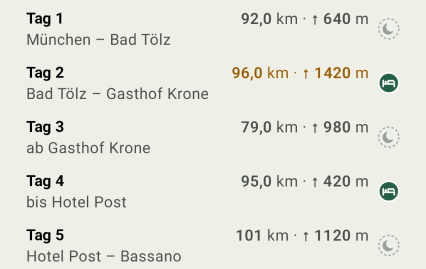
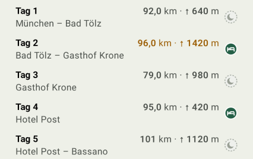
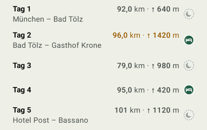

# Tage-Liste: Name, wenn nur ein Ende bekannt ist

Tag 3 beginnt im Gasthof Krone, Tag 4 endet im Hotel Post. Am anderen Ende dieser Tage liegt kein Ort in der Nähe.

### 1. Mit „ab“ und „bis“ (mein Vorschlag)
Man sieht den Namen und auch, ob der Tag dort beginnt oder endet.

### 2. Nur der Name
Kürzer, aber „Gasthof Krone“ bei Tag 3 sieht aus, als würde man dort am Abend ankommen. Tatsächlich fährt man dort los.

### 3. Keine Zeile (so ist es heute)
Deine Regel „beide Orte oder keiner“ ohne Ausnahme.

